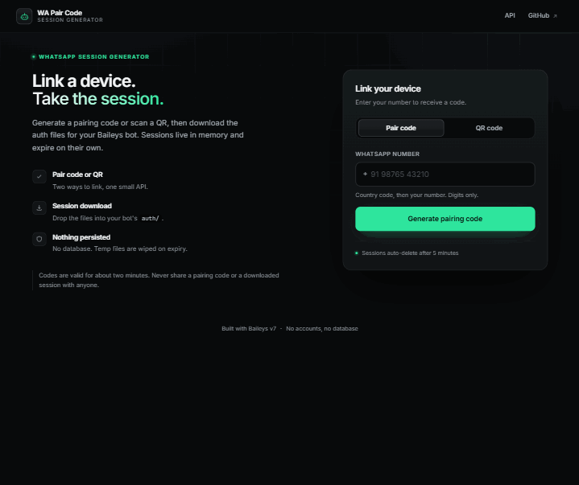
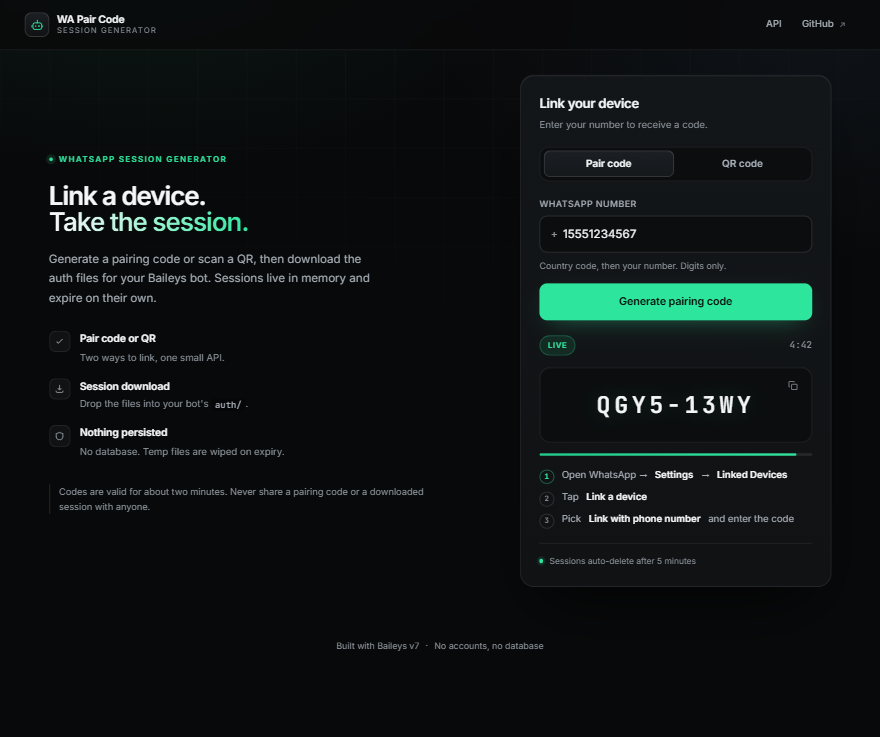
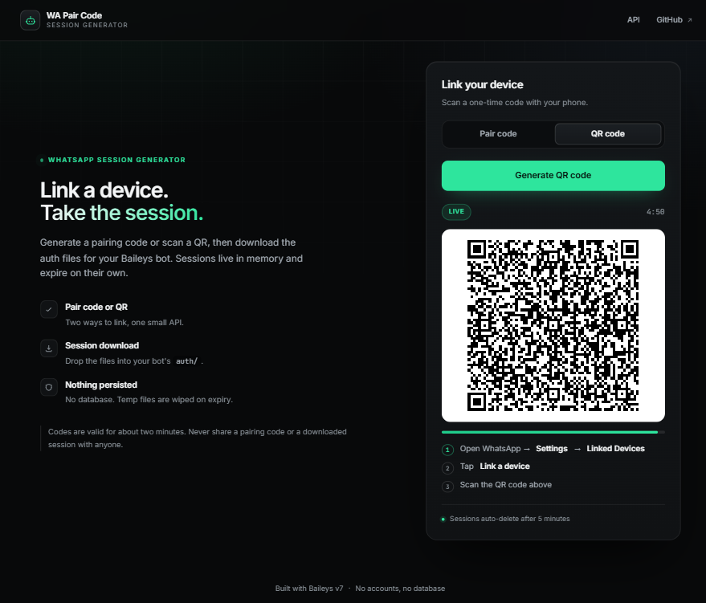
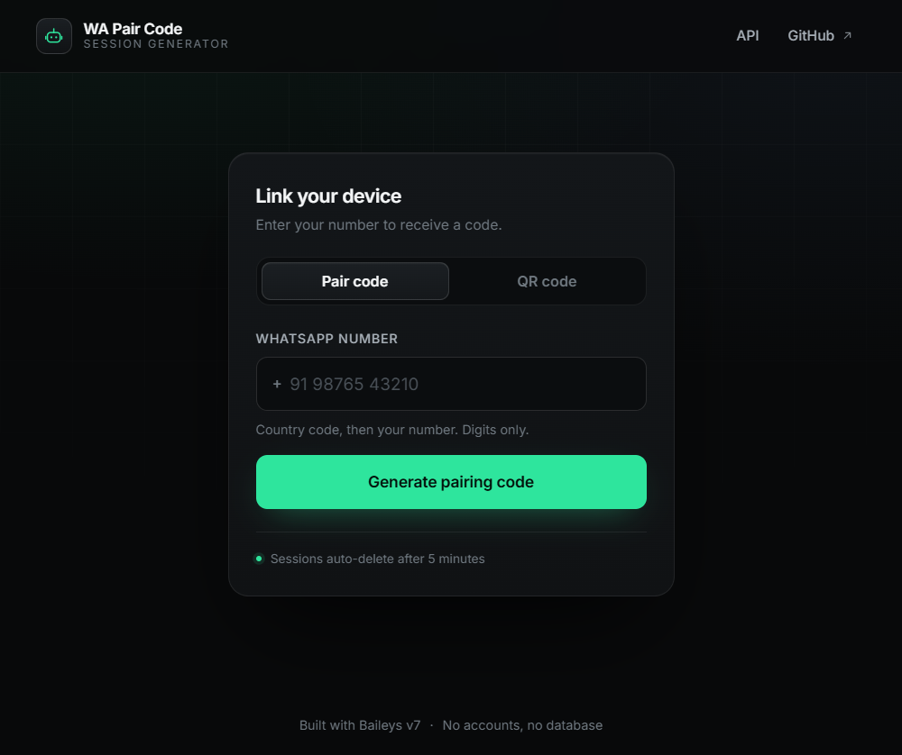

# WA Pair Code

A small self-hosted web service that links a WhatsApp device and hands the session back to you.

Type a number, get an 8-character pairing code, enter it in WhatsApp, then download a zip of the auth files. Or scan a QR instead. Built on [`@whiskeysockets/baileys`](https://github.com/WhiskeySockets/Baileys) v7 — no database, no API keys, no external services.



[](https://nodejs.org)
[](https://github.com/WhiskeySockets/Baileys)
[](#tests)
[](#deploy)
[](./LICENSE)



> ## ⚠️ Read this first
>
> The files this service gives you are **full access to that WhatsApp account**. Anyone who has them can read and send messages as that number.
>
> - Only ever generate a code for **your own** number.
> - Never enter a pairing code that someone else sent you.
> - Never upload the downloaded zip anywhere, never commit it, never share it.
> - The server keeps your session in memory and in a temp directory only until it expires — but whoever operates the server *can* read it while it is there. Self-host it, or use a host you trust.

---

## Contents

- [Screenshots](#screenshots)
- [Run locally](#run-locally)
- [Deploy](#deploy)
- [API](#api)
- [Configuration](#configuration)
- [Using the downloaded session](#using-the-downloaded-session)
- [How it works](#how-it-works)
- [Design system](#design-system)
- [Tests](#tests)
- [License](#license)

---

## Screenshots

**Pairing code** — the code is the loudest element on the page, with a copy button, a live badge and a countdown rail.


**QR code** — the same flow without typing a number.



**Single-column layout** — the hero collapses below 900px and the card takes over.



---

## Run locally

```bash
git clone https://github.com/inyogeshwar/wa-pair-code.git
cd wa-pair-code
npm install
cp .env.example .env      # optional — every value has a default
npm start
```

Open <http://localhost:3000>.

**Requirements:** Node 20+ (Node 22 recommended).

```bash
npm test                  # 6 unit tests, offline
docker build -t wa-pair-code .
docker run -p 3000:3000 -e MAX_SESSIONS=2 wa-pair-code
```

---

## Deploy

[](https://render.com/deploy?repo=https://github.com/inyogeshwar/wa-pair-code)

### Option A — Render (recommended)

Render's free web service supports the long-lived WebSocket Baileys needs, and `render.yaml` already declares the plan, the health check and every environment variable.

1. Click the button above (or **New → Blueprint** in the Render dashboard) and pick this repo.
2. **Apply.** Render builds with `npm install` and starts with `npm start`.
3. Done — the first request after idle can take ~50 seconds while the free instance wakes up.

Prefer manual setup? **New → Web Service → Node**, build `npm install`, start `npm start`, plan **Free**, health check path `/healthz`.

**Free-plan limits:** 512 MB RAM, sleeps after ~15 minutes without traffic. `MAX_SESSIONS=2` is the practical ceiling.

### Option B — Docker, anywhere (Koyeb, Fly.io, a VPS)

```bash
docker build -t wa-pair-code .
docker run -d -p 3000:3000 --init --restart unless-stopped \
  -e MAX_SESSIONS=2 -e TRUST_PROXY=true wa-pair-code
```

On Koyeb: create a Web Service from the repo, expose port 3000, free instance, health check `/healthz`.

### Option C — Hugging Face Spaces (Docker SDK)

Create a Space with the **Docker** SDK, upload this folder, set the app port to `3000`. Works, but the free CPU tier is slow and also sleeps.

### Option D — Botkeep

Botkeep runs Node.js workloads 24/7 without a renewal timer. Its panel injects **`SERVER_PORT`** instead of `PORT`; the app reads both, so no code change is needed.

1. **Create → Application → Node.js**, connect this repo, start command `npm start`.
2. Give the workload **512 MB RAM** (the app idles at ~115 MB and adds ~20 MB per live session).
3. Environment: `MAX_SESSIONS=6`, `MAX_STORED_SESSIONS=40`, `TRUST_PROXY=true`.
4. Open the **Network** tab, note the assigned port, then add a **Domain** in the panel — HTTP access is routed through Domains, not raw ports.
5. Health check: `/healthz`.

The Founder plan (5 slots, 2 GB RAM) can run one instance with `MAX_SESSIONS=8` or several smaller ones — but keep a single instance unless you add sticky routing, because sessions live in that process's memory.

### Not suitable

Vercel, Netlify, Cloudflare Workers — serverless functions cannot hold the WebSocket that Baileys needs.

---

## API

All responses are JSON. Errors look like `{ "error": "…", "code": "…" }`.

### `POST /api/pair`

```json
{ "number": "919876543210" }
```

`201` →

```json
{
  "id": "0f2c…",
  "mode": "pair",
  "status": "awaiting",
  "code": "ABCD-EFGH",
  "qr": null,
  "error": null,
  "expiresAt": 1760000000000,
  "secondsLeft": 300
}
```

### `POST /api/qr`

No body. Same shape, with `qr` set to a `data:image/png;base64,…` URL.

### `GET /api/session/:id`

Current status. Poll every ~2 s — it also returns refreshed QR images.

`status` is one of `requesting`, `awaiting`, `paired`, `failed`.

### `GET /api/session/:id/download`

Zip of the auth files. Only works when `status` is `paired`. Downloading also closes the server's socket so your bot can take over the credentials.

### `POST /api/session/:id/release`

Closes the socket and deletes the temp auth files immediately.

### `GET /api/config` · `GET /healthz`

UI configuration and `{ "ok": true, "uptime": 42, "sessions": 3, "slots": 1, "maxSlots": 2 }`.
`sessions` counts everything kept on disk; `slots` counts only sessions that still need a socket.

---

## Configuration

| Variable | Default | Meaning |
|---|---|---|
| `PORT` / `SERVER_PORT` | `3000` | HTTP port (Botkeep injects `SERVER_PORT`) |
| `HOST` | `0.0.0.0` | Bind address |
| `AUTH_DIR` | OS temp dir | Where temporary auth folders live |
| `BOT_NAME` | `WA Pair Code` | Page title and brand |
| `ALLOW_PAIRING` | `true` | Enable the pair-code tab |
| `ALLOW_QR` | `true` | Enable the QR tab |
| `MAX_SESSIONS` | `2` | Concurrent sockets (memory guard) |
| `MAX_STORED_SESSIONS` | `40` | Hard cap on sessions kept on disk, paired ones included |
| `SESSION_TTL_MS` | `300000` | How long the user has to finish linking |
| `PAIRED_KEEP_MS` | `600000` | How long a linked session stays downloadable |
| `READY_TIMEOUT_MS` | `30000` | WhatsApp handshake timeout |
| `RATE_LIMIT` | `5` | Requests per IP per window |
| `RATE_WINDOW_MS` | `600000` | IP window |
| `NUMBER_LIMIT` | `2` | Requests per number per window |
| `NUMBER_WINDOW_MS` | `600000` | Number window |
| `TRUST_PROXY` | `true` | Read the client IP from `X-Forwarded-For` |
| `LOG_LEVEL` | `info` | Server log level |

---

## Using the downloaded session

1. Unzip the download.
2. Create an `auth/` folder next to your bot.
3. Copy every `.json` file into it.
4. Start your bot — it connects without asking for a QR or a code.

Keep the zip and the files private. If you lose them, link the device again and remove the stale entry in **WhatsApp → Linked Devices**.

This service is the companion to **[whatsapp-ai-bot](https://github.com/inyogeshwar/whatsapp-ai-bot)**, but the zip it produces works with any Baileys v7 project that uses a multi-file auth state.

---

## How it works

- `POST /api/pair` opens one temporary Baileys socket. It waits for the first `connection.update` carrying a `qr` payload — Baileys' "the socket is ready" signal — and only then calls `requestPairingCode()`. Calling it earlier throws `Connection Closed`.
- Neither WhatsApp nor Baileys keeps that socket alive on its own: WhatsApp drops it after its last QR ref (~2 minutes) and again with `515` right after a device links. The manager reopens it in both cases, so the QR stays scannable for the whole session.
- On `connection === 'open'` the session is marked `paired`; 1.5 s later the socket is closed *without* logging out, which would invalidate the fresh credentials. Only the auth files remain, so the slot is free for the next visitor immediately.
- `MAX_SESSIONS` limits sockets, not downloads: linked sessions stay downloadable for `PAIRED_KEEP_MS` without occupying a slot. `MAX_STORED_SESSIONS` caps the files kept on disk.
- A sweeper runs every 15 s, deleting expired sessions and their temp directories.
- The front-end polls `/api/session/:id` every 2 s and stops when the tab is hidden.

---

## Design system

The UI is built from a written design contract, not from ad-hoc CSS. [`DESIGN.md`](./DESIGN.md) holds machine-readable tokens (colours, type scale, radii, spacing, components) plus the rationale for each decision — the same format described at [google-labs-code/design.md](https://github.com/google-labs-code/design.md). It lints clean against the reference linter:

```bash
npm run lint:design
# { "errors": 0, "warnings": 0 }
```

The short version:

| | |
|---|---|
| **Canvas** | `#08090A`, with two very low-opacity radial washes and a 64px grid |
| **Surfaces** | A four-step charcoal ladder (`#0B0D0F` → `#1B1F23`) does the work that shadows usually do |
| **Borders** | 1px white at 7% / 13% — hairlines, never solid grey |
| **Accent** | A single emerald, `#2EE59D`, reserved for interaction and success |
| **Type** | Inter for prose, JetBrains Mono for the pairing code and machine values |
| **Motion** | State changes only; everything collapses under `prefers-reduced-motion` |

The pairing code is deliberately the loudest object on the page — 34px mono with 5px tracking, grouped 4-4 so it reads from an arm's length away.

Two details the linter forced, and both were real bugs:

- Every small label clears WCAG AA. The idle tab label was `#6F7880` on `#0B0D0F` — 4.33:1, just under the 4.5:1 line — so it now uses `ink-muted` (8.7:1). Secondary body text moved to `#8A9299` (6.0:1).
- Status badges use pre-composited backgrounds instead of `rgba()`, so the contrast you measure is the contrast that actually gets painted (emerald on `#142B24` is 9.2:1).

---

## Tests

```bash
npm test
```

Four offline unit tests over the pure helpers (`normalizeNumber`, `formatCode`, `maskNumber`) — no WhatsApp account required. GitHub Actions runs them on Node 20 and 22.

---

## License

MIT — see [LICENSE](./LICENSE). Use it on your own number.
